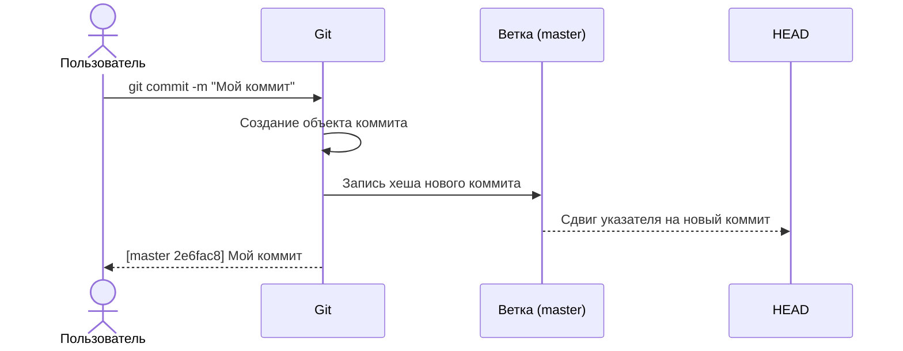

# Шпаргалка по основным понятиям и командам Git

*Создана для быстрого доступа к нужной информации* 
*Автор: Акулова Людмила*

---
## Содержание
- [Создание репозитория](#создание-репозитория)
- [Основные команды для работы](#основные-команды-для-работы)
  - [1. Просмотр истории (git log)](#1-просмотр-истории-git-log)
- [Работа с удаленными репозиториями](#работа-с-удаленными-репозиториями)
  - [1. Настройка SSH-ключа](#1-настройка-SSH-ключа)
  - [2. Привязываем SSH-ключ к GitHub](#2-привязываем-SSH-ключ-к-GitHub)
- [Хеш - идентификатор коммита](#хеш-идентификатор-коммита)
  - [1. Главные свойства хеша](#1-главные-свойства-хеша)
  - [2. Где хранится?](#2-где-хранится)
  - [3. Из чего состоит?](#3-из-чего-состоит)
- [Файл HEAD](#файл-HEAD)
  - [1. Что происходит при коммите?](#1-что-происходит-при-коммите)

---

## Создание репозитория

**Git-репозиторий** (от англ. *repository* — «хранилище») — это папка проекта, за изменениями в которой следит Git. Внутри неё появляется скрытая папка `.git`, Git будет хранить всю служебную информацию.

| Команда | Описание | Примечание |
| :--- | :--- | :--- |
| `git init` | Создаём репозиторий локально | **_git init_** выведет сообщение:  `Initialized empty Git repository in <*ваша папка с проектом*>/.git/` |
| `rm -rf .git` | «Разгитить» папку, если что-то пошло не так | **-r** — удалить папки вместе с их содержимым;  **-f** — избавляет от вопросов вроде «Вы точно хотите удалить этот файл? А этот? И этот тоже?» |

---

## Основные команды для работы

**Коммит** (от англ. *commit* — «фиксировать») — это одна из основных сущностей в Git (и в других системах контроля версий). Коммит гарантирует, что изменения будут сохранены в истории и при необходимости к ним можно будет «откатиться».

| Команда | Описание | Примечание |
| :--- | :--- | :--- |
| `git add` | Подготовка файлов к сохранению | **git add --all** — подготовить все файлы; **git add todo.txt** — один файл; **git add .** — добавить всю текущую папку |
| `git status` | Проверить текущее состояние репозитория ||
| `git commit` | Сохранение изменений в истории | **-m** — для добавления сообщения коммита.  **Пример:** *git commit -m "Мой первый коммит"*|
| `git log` | Просмотреть историю коммитов |По умолчанию **_git log_** выводит коммиты в **обратном хронологическом порядке** - последние коммиты оказываются первыми сверху.  `git log --oneline` - сокращённый хеш (уникальный в пределах репозитория)|

### 1. Просмотр истории (git log)

<u>Элементы, из которых состоит описание:</u>
* строка из цифр и латинских букв после слова commit — это хеш коммита;
* Author — имя автора и его электронная почта;
* Date — дата и время создания коммита;
* в конце находится сообщение коммита.

---

## Работа с удаленными репозиториями
### 1. Настройка SSH-ключа
**Сетевые протоколы** (англ. network protocols) — правила обмена данными между компьютерами.

**SSH** (от англ. Secure Shell Protocol) наиболее распространённый сетевой протокол. 
<u>Он использует пару ключей для обеспечения безопасности — публичный и приватный:</u>  
- **_Приватный ключ_** (англ. private key) хранится только на вашем компьютере и не должен передаваться кому-либо ещё. Он используется для расшифровки данных. 
- **_Публичный ключ_** (англ. public key) доступен всем и используется для шифрования данных. Они могут быть расшифрованы парным приватным ключом.

| Команда | Описание | Примечание |
| :--- | :--- | :--- |
|`ls -a ~/.ssh/` | Проверка уже созданных SSH-ключей | Если там есть ключи, которые вы не создавали — их лучше удалить.  **Примеры SSH-ключей:** <ul><li>id_dsa.pub;</li><li>id_ecdsa.pub;</li><li>id_ed25519.pub;</li><li>id_rsa.pub.</li></ul> |
|  `ssh-keygen -t ed25519 -C "email@example.com"` | Генерация SSH-пары используя программу `ssh-keygen`|Если система не поддерживает `ed25519`:  `ssh-keygen -t rsa -b 4096 -C "email@example.com"`|

### 2.Привязываем SSH-ключ к GitHub
| Команда | Описание | Примечание |
| :--- | :--- | :--- |
| `clip < ~/.ssh/id_ed25519.pub` | Копирование содержимого публичного ключа в буфер обмена (Windows) | Если у вас ключ `rsa`, используйте: `clip < ~/.ssh/id_rsa.pub`|
| `ssh -T git@github.com` | Проверка правильности ключа |**_При первом использовании Git отображается предупреждение:_**  *"The authenticity of host 'github.com (140.82.121.4)' can't be established.  ED25519 key fingerprint is SHA256:+DiY3wvvV6TuJJhbpZisF/zLDA0zPMSvHdkr4UvCOqU.  This key is not known by any other names.  Are you sure you want to continue connecting (yes/no/[fingerprint])?"*  **После ввода _yes_ отображается следующее сообщение:** *"Hi %ВАШ_АККАУНТ%! You've successfully authenticated, but GitHub does not provide shell access."* |
| `git remote add origin <URL>` | Привязать удалённый репозиторий к локальному | **Пример:**  *git remote add origin git@github.com:username/first-project.git* где **_origin_** — стандартный псевдоним главного удалённого репозитория. |
| `git remote -v` | Проверка, что репозитории связаны | **-v** — короткая форма флага `--verbose` (показывает подробную информацию) |
| `git push` | Отправить изменения на удалённый репозиторий |В первый раз эту команду нужно вызвать с флагом `-u` и параметрами `origin` (имя удалённого репозитория) и `main` или `master` (название текущей ветки):    *git push -u origin main* Если команда выдаёт ошибку, попробуйте заменить `main` на `master` |

## Хеш - идентификатор коммита

**Хеширование** (от англ. *hash*, «рубить», «крошить», «мешанина») — это способ преобразовать набор данных и получить их «отпечаток» (англ. *fingerprint*).

<u>Информация о коммите — это набор данных:</u>
* когда был сделан коммит;
* содержимое файлов в репозитории на момент коммита;
* ссылка на предыдущий (родительский) коммит;
* автор и текст сообщения коммита.

Git хеширует (преобразует) информацию о коммите с помощью алгоритма SHA-1 (от англ. *Secure Hash Algorithm* — «безопасный алгоритм хеширования») и получает для каждого коммита свой уникальный хеш — **результат хеширования для каждого коммита свой**

### 1. Главные свойства хеша
* если хеш получить дважды для одного и того же набора входных данных, то результат будет гарантированно одинаковый;
* если хоть что-то в исходных данных поменяется (хотя бы один символ), то хеш тоже изменится (причём сильно).

### 2. Где хранится?
Хеш и связанная с ним информация хранятся в служебном файле Git (внутри скрытой папки `.git`), в виде таблицы *соответствий хеш → информация* о коммите.

### 3. Из чего состоит?

<u>Хеш состоит из:</u>
- цифр 0-9
- латинских букв A-F (неважно, заглавных или строчных).

*Пример хеша: 51851e96708e7ecb2ea1e3678405b88ec70b0eea*

## Файл HEAD

**Файл HEAD** (англ.*«голова»*, *«головной»*) — один из служебных файлов папки .git. Он указывает на коммит, который сделан **последним (то есть на самый новый)**.

В файле `HEAD` содержится **_ссылка на служебный файл:_** 
<pre>refs/heads/master (или refs/heads/main в зависимости от названия ветки)</pre>

При переходе в этот файл, можно увидеть хеш последнего коммита.
<pre>$ cat .git/refs/heads/master # взяли ссылку из файла HEAD
# внутри хеш
e007f5035f113f9abca78fe2149c593959da5eb7</pre>

### 1. Что происходит при коммите?

